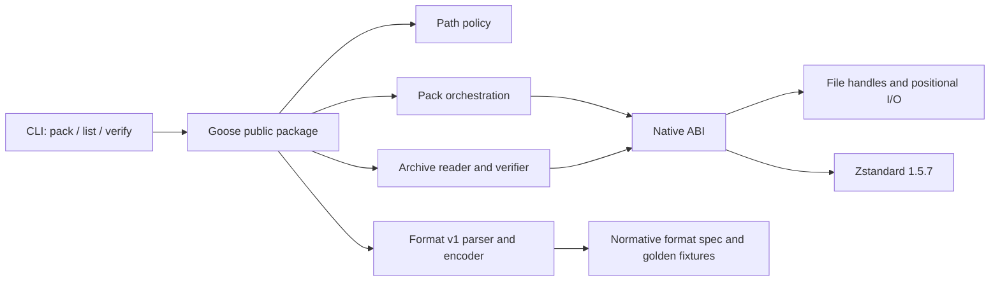

# gpack v1 architecture

This document maps the accepted design in the [product specification](spec.md)
onto implementation modules. The package/build foundation, v1 format
primitives, raw packing, and runtime reads are implemented.
The native seam follows the measured [Goose boundary findings](../research/wayfinder-goose-boundary.md)
and the H3 [pack](../research/experiments/h3-native-streaming-boundary/results.md)
and [runtime](../research/experiments/h3-runtime-lookup/results.md) results.

## Module boundary



The Goose package owns every GPack semantic decision: canonical paths, format
validation, index construction, deterministic ordering, raw-versus-Zstandard
selection, checksums, and API errors. The C target does not know GPack magic,
versions, entry records, paths, or layouts. It provides narrow operations for
read/write handles, positional I/O, flush/atomic replace, and Zstandard
compression/decompression. Goose owns CRC32 and all GPack validation.

Keep ABI declarations in `src/gpack/native/gpack_native.h`; include the same
header in separately compiled native sources and through the Goose package's
`.build` sidecar. Pin the Goose compiler because Goose/C struct ABI layout is a
toolchain contract, not a general stable C ABI.

## Data flow

### Packing

1. Recursively enumerate regular files; reject symlinks, other non-regular
   entries, invalid paths, and duplicate canonical path bytes.
2. Sort the manifest by canonical UTF-8 path bytes and snapshot file identity
   metadata.
3. For each asset in that order, read and checksum its source bytes, encode a
   single Zstandard frame at the pinned settings, and choose the frame only if
   it is smaller than raw bytes.
4. Stream payloads to a sibling temporary archive in manifest order. Keep
   metadata records in Goose and bound concurrent buffers by the configured
   worker/read limits.
5. Recheck source identity, encode the index and checksums, finalize the
   header, flush and atomically replace the destination.

The initial implementation should use a sequential pack path. Parallel
compression can follow only if measurements show useful gains without
violating deterministic ordering or memory limits.

### Runtime read

1. Open the archive read-only and read the fixed header and bounded index with
   positional I/O.
2. Goose validates the complete index before constructing its path lookup.
3. A path read resolves one entry, enforces the configured uncompressed-size
   limit, reads exactly its stored range, decodes raw or one Zstandard frame,
   and verifies the content CRC32.
4. Up to four reads may be in flight by default. Each uses positional reads on
   the same archive handle; there is no shared file cursor.

`reader::read` provides a synchronous path read. To cross Goose's isolated
worker boundary, callers resolve a path into a flat `ReadRequest` and dispatch
up to four `reader::read_worker` tasks; each result carries its ticket and
verified bytes. The archive must remain open until those workers finish.

`list` prints validated index metadata. `verify` routes each record through the
same full-asset read and integrity path as the runtime API.

Compressed frames up to 1 MiB use a bounded one-shot native decode after the
reader confirms the exact frame extent. Larger frames retain streaming decode,
which bounds temporary compressed-input memory for large assets.

## Canonical source tree

```text
cmd/gpack.goose
src/gpack/
  gpack.goose
  gpack.build
  CMakeLists.txt
  format.goose
  paths.goose
  pack.goose
  reader.goose
  verify.goose
  native/gpack_native.h
  native/io.c
  native/codec.c
third_party/zstd-1.5.7/
tests/
  *.goose
  fixtures/
scripts/
docs/
  product/spec.md
  product/architecture.md
  product/risks.md
  format/v1.md
  research/experiments/
```

The `gpack` library is one Goose package. The CLI and test executables are
separate Goose roots that import it by local path. `gpack.build` names the
static CMake target. A provider-neutral script layer owns format, check, build,
and test commands; the chosen CI service runs the same entrypoints on native
workers.

## Contract propagation

`docs/format/v1.md` defines wire compatibility. Goose is the only parser and
writer, so no generated C format structures are needed. Golden archives cover
all v1 codecs and boundary conditions; tests assert exact bytes from the
pinned build. The native header is the one ABI contract, checked by compiling
the Goose declarations and native functions together. Any format change must
update the normative spec, Goose implementation, golden fixtures, and format
version policy in one change.

## Implementation order

The blocker-linked sequence is maintained under
`.scratch/gpack-foundation/issues/`. The first slice is the repo/native build
foundation, then a raw pack/read vertical slice, followed by Zstandard and
integrity, CLI verification, runtime performance acceptance, and the full
platform release matrix. Do not implement deduplication or parallel packing
before measurements justify them.
